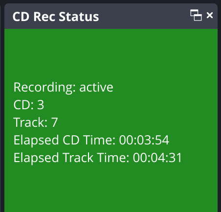

# CD Rec status

An [OBS](https://github.com/obsproject/obs-studio) plugin to display the status of an ongoing cd recording as a dock.



The [offical obs plugin template](https://github.com/obsproject/obs-plugintemplate) was used to create this plugin.

## How it works
This plugin listens in on a websocket server on `ws://localhost:8765` from which it receives messages like:
```json
{
  "recording": true,
  "cd": 3,
  "track": 7,
  "cd_time": "12:03",
  "track_time": "01:26"
}
```

An example implementation of such a websocket can be found [here](https://github.com/noahvogt/slidegen/blob/master/cd_recording_status_websocket.py).

It then adds a dock on the obs studio interface titled *CD Rec Status* that displays the state of the (ongoing) cd recording.

## Installation
Download `cd-rec-status-linux-x86_64.tar.gz` from the [latest release](https://github.com/noahvogt/obs-cd-rec-status/releases) and extract it into your OBS plugin directory. For the OBS Flatpak (`com.obsproject.Studio`) that is:

```bash
mkdir -p ~/.var/app/com.obsproject.Studio/config/obs-studio/plugins
tar -xzf cd-rec-status-linux-x86_64.tar.gz -C ~/.var/app/com.obsproject.Studio/config/obs-studio/plugins/
```

This creates `cd-rec-status/bin/64bit/cd-rec-status.so` and `cd-rec-status/data/` in the plugin directory. Restart OBS afterwards. If the dock is hidden, enable it via the *Docks* menu.

## Building
Releases are built by the GitHub workflow in `.github/workflows/release.yml`, which runs whenever a tag of the form `vMAJOR.MINOR.PATCH` (e.g. `v1.2.0`) is pushed. It writes the version from the tag into `buildspec.json`, builds the plugin as a Flatpak extension against the `com.obsproject.Studio` runtime with `flatpak-builder`, packages `cd-rec-status.so` together with the `data` directory and publishes the tarball as a GitHub release. The workflow can also be started manually from the *Actions* tab; such a run only uploads the tarball as a build artifact and creates no release.

To build locally, follow the same steps as the workflow: generate its `plugin.json` manifest and run `flatpak-builder` with it. When a new OBS Flatpak runtime is released and OBS no longer loads the plugin, push a new tag to build a matching release.

## Roadmap
Possible changes in future releases:
- add de locale
- allow the configuration of hostname + port of the websocket via the obs gui
- better text styling than just QLabels
